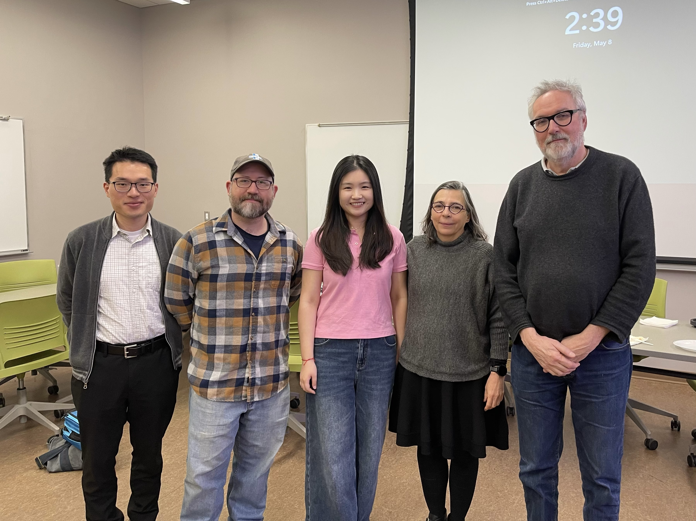

Syntax · Semantics · Language acquisition

I study how children acquire syntax and semantics, combining behavioral experiments and computational modeling to investigate the relationship between language and cognition.

I have defended my PhD dissertation and completed the Graduate Specialization in Cognitive Science at Michigan State University (MSU).

<a class="button" href="/research/">Explore my research →</a><a class="button secondary" href="/Xu_CV_mar_2026.pdf">Download CV (PDF)</a><a href="mailto:xujing21@msu.edu">Email me</a>

<section><h2>Academic community</h2>
My advisor is <a href="https://people.cal.msu.edu/schmit12/">Cristina Schmitt</a>. Alan Munn, Brian Buccola, and Alan Hezao Ke are also on my committee.

I'm part of the <a href="https://www.msuacquisition.org/index.html">MSU Language Acquisition Lab</a>, Semantics-Pragmatics Lab, and <a href="https://sites.google.com/view/mlclab">Minimalism, Learning and Computational Psycholinguistics Lab</a>.
<figure class="defense"><figcaption>Celebrating my PhD defense with my committee.</figcaption></figure></section><section><h2>Beyond linguistics</h2>
Outside of linguistics, I enjoy reading and handcrafting.
</section>
