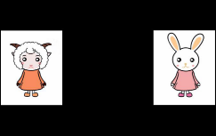

<nav class="topic-nav" aria-label="Research topics"><a href="#aspect-and-telicity">Aspect & telicity</a><a href="#modeling-syntactic-parameter-setting">Learning syntactic parameters</a><a href="#acquisition-of-mandarin-control-structures">Mandarin control structures</a><a href="#mandarin-count-mass-issue">Countability in Mandarin</a><a href="#negative-wh-pronouns">Negative wh-pronouns</a></nav><section class="project" id="aspect-and-telicity">
Research theme 01
<h2>Aspect and Telicity</h2>
How do language and context shape judgments about whether an event is complete?
<figure class="research-figure telicity-videos">
<video controls playsinline preload="metadata" aria-label="Telicity demonstration 1"><source src="/assets/img/eat_uig.mp4" type="video/mp4">Your browser does not support embedded video. <a href="/assets/img/eat_uig.mp4">Download video 1</a>.</video><video controls playsinline preload="metadata" aria-label="Telicity demonstration 2"><source src="/assets/img/eat_uig2.mp4" type="video/mp4">Your browser does not support embedded video. <a href="/assets/img/eat_uig2.mp4">Download video 2</a>.</video>
<figcaption><strong>Can we describe each video with these sentences?</strong> “I ate those cookies.” “I ate three cookies.”</figcaption></figure>

Read the full project description

Do Mandarin and English speakers judge sentences like “She ate those/three cookies” and <em>Ta chi-le na-ji-kuai/san-kuai binggan</em> the same way when not all cookies are fully eaten? Why do children and adults sometimes differ in their judgments? These questions are at the center of this project. Classical semantic theories treat telicity as compositionally derived from the interaction between verbs and their objects, and they typically assume that telic predicates in non-progressive form entail completion. But Mandarin has long posed a challenge to this view, because speakers may accept apparently telic sentences even in incomplete situations.

Using truth-value judgment experiments with English-speaking adults and Mandarin-speaking children and adults, I argue that these patterns reflect not a fundamentally different semantics, but differences in how linguistic meanings are verified against visual and discourse context. The project shows that (1) the mapping between language and the world is mediated by event representations shaped by both linguistic and perceptual information, (2) Mandarin incremental-theme predicates can be explained without special language-specific machinery, and (3) developmental differences arise not from immature semantic knowledge, but from children’s developing ability to integrate language, perception, and context during interpretation.

Selected papers
<ul>
<li><strong>Xu, Jingying</strong>, &amp; Cristina Schmitt. (2026). <a href="https://journals.linguisticsociety.org/proceedings/index.php/PLSA/article/view/6115">Telicity in Context: Evidence from Mandarin-Speaking Children and Adults</a>. Proceedings of the Linguistic Society of America (PLSA 2026).</li>
<li><strong>Xu, Jingying</strong>, &amp; Cristina Schmitt. (2025). <a class="paper-pdf" href="/CLS_xu_schmitt.pdf">Grammatical versus pragmatic accounts for event non-culmination in Mandarin: An experimental study</a>. Proceedings of the 60th Meeting of the Chicago Linguistic Society (CLS 60). pp 429-440.</li>
</ul>
<a href="/publications/#aspect-and-telicity">All publications from this project →</a>

Presentations (12)
<ul>
<li><strong>Xu, Jingying</strong>, &amp; Cristina Schmitt. (2026). Telicity judgments as a window onto the mapping between language and events. Oral presentation at Ontology As Structured by the Interfaces with Semantics 6 (OASIS 6), Lisbon, Portugal</li>
<li><strong>Xu, Jingying</strong>, &amp; Cristina Schmitt. (2026). Mapping event representations to linguistic representations: Mandarin children's and adults' culmination judgements. Oral presentation at the 42nd Portuguese Linguistics Association Annual Meeting (ENAPL42), Faro, Portugal</li>
<li><strong>Xu, Jingying</strong>, &amp; Cristina Schmitt. (2026). Learning telicity in context: Developmental evidence from Mandarin children. Oral presentation at 2026 LSA Annual Meeting, New Orleans.</li>
<li><strong>Xu, Jingying</strong>, &amp; Cristina Schmitt. (2026). Beyond truth conditions: Context modulates telicity interpretation. Oral presentation at 2026 LSA Annual Meeting, New Orleans.</li>
<li><strong>Xu, Jingying</strong>, &amp; Cristina Schmitt. (2024). Children do not have different verb representations from adults: Non-culminating incremental theme predicates in Mandarin-speaking children. Poster presentation at the 16th Generative Approaches to Language Acquisition (GALA 16). The NOVA University of Lisbon, Lisbon.</li>
<li><strong>Xu, Jingying</strong>, &amp; Cristina Schmitt. (2024). Demonstratives but not verbs cause non-culmination in Mandarin incremental-theme predicates: Evidence from children and adults. Poster presentation at the 34th Semantics and Linguistic Theory (SALT 34), University of Rochester, Rochester.</li>
<li><strong>Xu, Jingying</strong>, &amp; Cristina Schmitt. (2024). Non-culmination in telic incremental theme predicates: An experimental study of Mandarin children and adults. <a class="paper-pdf" href="/CLS_Poster_Jingying_Xu.pdf">Poster</a> presentation at the 60th Annual Meeting of the Chicago Linguistic Society (CLS 60), University of Chicago, Chicago. </li>
<li><strong>Xu, Jingying</strong>, &amp; Cristina Schmitt. (2024). Demonstratives but not verbs cause non-culmination in Mandarin incremental-theme predicates: Evidence from children and adults. Poster presentation at the 42nd West Coast Conference on Formal Linguistics (WCCFL 42), Berkeley.</li>
<li><strong>Xu, Jingying</strong>, &amp; Cristina Schmitt. (2024). How can Mandarin children and adults eat three cookies without ever finishing them? Oral presentation at the 48th annual Penn Linguistics Conference (PLC 48), Philadelphia.</li>
<li><strong>Xu, Jingying</strong>. (2023). How can you eat three cookies without ever finishing them?  Oral presentation at Careers, Alumni and Linguistics at Michigan State (CALMS) 2023, East Lansing.</li>
<li><strong>Xu, Jingying</strong>, &amp; Cristina Schmitt. (2023). Tracing the trajectory of the telicity calculus in Mandarin-speaking children. Poster presentation at CreteLing 2023 Conference, Rethymnon, Crete.</li>
<li><strong>Xu, Jingying</strong>. (2022). Telicity in Mandarin preschoolers. Oral presentation at the Graduate Linguistics Expo at Michigan State (GLEAMS) 2022, East Lansing.</li>
</ul>
</section><section class="project" id="modeling-syntactic-parameter-setting">
Research theme 02
<h2>Modeling Syntactic Parameter Setting</h2>
How do children find a grammar without testing every possible parameter setting?

Read the full project description

How do children identify the grammar of their language from limited input? Within the Principles and Parameters framework, this means explaining how learners navigate a space of possible parameter settings without exhaustively testing every grammar. This project introduces a computational model of a novel hierarchical approach to parameter setting, and argues that parameters, whether innate or derived from innate properties or another source, remain necessary within the Minimalist approach.

By directly comparing grammar selection and direct parameter setting, two approaches often treated separately, we show that each captures part of the learning problem. We then propose an input-driven, hierarchical <strong>Clustering Approach</strong> that combines their strengths: it updates only the parameters supported by the input and uses the order of acquisition to organize the hypothesis space more efficiently. The result is a more scalable model of parameter setting that resolves a key limitation of earlier hybrid accounts.

Selected papers
<ul>
<li>Ke, Alan Hezao, <strong>Jingying Xu</strong>, &amp; Lijun Ding. (2025). Modeling the Learning of Parametric Variation: Implementing an input-driven hierarchical approach. Glossa: a journal of general linguistics 10(1). DOI: <a href="https://doi.org/10.16995/glossa.18053">DOI</a></li>
<li>Ke, Alan Hezao, <strong>Jingying Xu</strong>, &amp; Lijun Ding. (2024). <a class="paper-pdf" href="/BUCLDProceeding_The_clustering_approach.pdf">The Clustering Approach: An Input-Driven Approach to Parameter Setting</a>. Proceedings of the 48th Annual Boston University Conference on Language Development (BUCLD 48).</li>
</ul>
<a href="/publications/#modeling-syntactic-parameter-setting">All publications from this project →</a>

Presentations (1)
<ul>
<li>Ke, Alan Hezao, <strong>Jingying Xu</strong>, &amp; Lijun Ding. (2023). The Clustering Approach: An Input-Driven Approach to Parameter Setting. <a class="paper-pdf" href="/BUCLD_48_Poster_The_clustering_approach_Ke_Xu_Ding.pdf">Poster</a> presentation at the 48th Annual Boston University Conference on Language Development (BUCLD 48), Boston.</li>
</ul>
</section><section class="project" id="acquisition-of-mandarin-control-structures">
Research theme 03
<h2>Acquisition of Mandarin Control Structures</h2>
How do young children interpret a subject that is not spoken aloud?
<figure class="research-figure control-figure"><figcaption><em>Xiaotu rang chi-fan.</em> bunny allow eat-meal “The bunny lets someone eat.”<strong class="control-question">Who eats?</strong></figcaption></figure>

Read the full project description

How do children figure out who is doing the action when the subject is never spoken aloud? Control constructions raise exactly this puzzle. In sentences like <em>X wanted [PRO to eat]</em> or <em>X asked Y [PRO to open the door]</em>, listeners must identify the silent subject of the embedded clause, represented as PRO, even though it has no overt pronunciation. This makes control a revealing test case for theories of language acquisition: does children’s early interpretation rely on superficial cues such as word order and proximity, or do they have access from early on to the hierarchical structure that determines reference? Mandarin offers a particularly strong testing ground for this question because it lacks overt morphological marking of control and freely allows null arguments, making the underlying structural cues especially important.

In this project, we investigated Mandarin-learning infants’ comprehension of complement control using the Intermodal Preferential Looking Paradigm (IPLP). We tested minimal contrasts such as subject control, <em>X xiang chi-fan</em> 'X wanted to eat', versus object control with a null object, <em>X rang (Y) chi-fan</em> 'X allows (Y) to eat', as well as object control with an overt object, <em>X rang Y kai-men</em> 'X asked Y to open the door', versus the superficially similar non-control structure <em>X gei Y kai-men</em> 'X opened the door for Y'. The results showed that Mandarin-learning two-year-olds can identify the understood referent of the silent subject, distinguish subject control from object control, and separate true control structures from lookalike non-control sentences. The project therefore provides early evidence that young children track abstract structural dependencies, supporting continuity-based accounts of language acquisition.

Selected papers
<ul>
<li>Yang, Xiaolu, <strong>Xu, Jingying</strong>, &amp; Shi, Rushen. (2025). <a class="paper-pdf" href="/ijchl.24006.yan.pdf">Mandarin-speaking two-year-old children’s comprehension of complement control: Evidence from a preferential looking experiment</a>. International Journal of Chinese Linguistics (IJChL) 12(2).</li>
<li><strong>Xu, Jingying</strong>, Xiaolu Yang, &amp; Rushen Shi. (2021). <a class="paper-pdf" href="https://www.lingref.com/bucld/45/BUCLD45-58.pdf">Complement control in early child grammar: A study of Mandarin-speaking two-year-olds’ comprehension</a>. In Daniell Dionne &amp; Lee-Ann Vidal Covas (Eds.), Proceedings of the 45th Annual Boston University Conference on Language Development (BUCLD 45). Somerville, MA: Cascadilla Press.</li>
</ul>
<a href="/publications/#acquisition-of-mandarin-control-structures">All publications from this project →</a>

Presentations (1)
<ul>
<li><strong>Xu, Jingying</strong>, Xiaolu Yang, &amp; Rushen Shi. (2020). Complement Control in Early Child Mandarin: Evidence from a Preferential Looking Experiment. <a class="paper-pdf" href="/control.pdf">Poster</a> presentation at the 45th Annual Boston University Conference on Language Development (BUCLD 45), Boston.</li>
</ul>
</section><section class="project" id="mandarin-count-mass-issue">
Research theme 04
<h2>Mandarin Count-Mass Issue</h2>
Where does countability come from in Mandarin, and how do children acquire it?
<figure class="research-figure countability-figure"><figcaption>
<strong>Can we say:</strong>

<em>Xiaotu chi-le xiao-luobo.</em> bunny eat-PFV small-carrot “The bunny ate the small carrot.”

<em>Tumama chi-le da-huluobo.</em> mother.rabbit eat-PFV big-carrot “The mother rabbit ate the big carrot.”
<small>PFV = perfective aspect</small></figcaption></figure>

Read the full project description

Are Mandarin nouns inherently specified as count or mass, or does countability emerge only through the structures they appear in? This question lies at the center of a long-standing debate about the nature of the Mandarin nominal system. One view treats countability as primarily <strong>syntactic</strong>: classifiers determine how nouns are individuated, while bare nouns remain mass-like or underspecified. Another treats it as <strong>semantic</strong>: nouns are lexically specified as count or mass, whether through their denotations or through restrictions on the classifiers they combine with. This project revisits that debate by asking not only how countability is represented in Mandarin, but also how children come to acquire it.

We present experimental evidence that Mandarin nouns are underspecified for countability, and that size- and shape-denoting adjectives, much like classifiers, can supply an individuation function that makes counting possible. The findings therefore broaden the locus of individuation beyond the classifier system itself. Developmentally, children acquire this adjectival contribution only gradually, in parallel with the protracted acquisition of classifier-based individuation. Taken together, the results argue for an underspecified view of Mandarin nouns and show that learning to count in Mandarin involves mastering multiple linguistic devices for carving entities into countable units.

Selected papers
<ul>
<li>Huang, Aijun, &amp; <strong>Jingying Xu</strong>. (2021). <a class="paper-pdf" href="/adjectival_modification.pdf">Hanyu xingrongci xiushi he hanyu keshuxing wenti tanjiu: Yixiang ertong yuyan xide yanjiu (Adjectival modification and countability in Mandarin Chinese: An L1 acquisition study) (in Chinese)</a>. Linguistic Research.</li>
</ul>
<a href="/publications/#mandarin-count-mass-issue">All publications from this project →</a>

Presentations (1)
<ul>
<li><strong>Xu, Jingying</strong>, &amp; Aijun Huang. (2016). Adjectival Modification and Countability in Mandarin Chinese: A View from First Language Acquisition. Oral presentation at the 5th Syntax and Semantics in China (SSiC 2016), Shanghai.</li>
</ul>
</section><section class="project" id="negative-wh-pronouns">
Research theme 05
<h2>Non-Interrogative Use of Mandarin Negative Wh-Pronoun Construction <em>mei...shenme</em> 'not...what'</h2>
How do learners acquire the different readings of mei…shenme (“not…what”)?

Read the full project description

In Mandarin, the <em>mei…shenme</em> (‘not…what’) construction supports a categorical <strong>None</strong> reading (e.g., <em>Xiaozhu mei chi shenme dongxi.</em> ‘Xiaozhu didn’t eat anything at all.’) and a scalar Insignificance reading (e.g., <em>Xiaozhu mei chi shenme dongxi.</em> ‘Xiaozhu ate very little.’). We find the L2 pattern mirrors L1: <strong>None</strong> before <strong>Insignificance</strong>, but on a more gradual curve. We consider linguistic and non-linguistic factors (e.g., input frequency, task and pragmatics factors) to account for similarities and differences across L1 and L2 acquisition.

Selected papers
<ul>
<li>Huang, Aijun, Qian Wang, <strong>Jingying Xu</strong>, Hui Chang, Li Zeng &amp; Nakayama Mineharu. (2026). Navigating Mandarin Subtleties: Korean Speakers' Acquisition of Mandarin's Negative wh-pronoun Construction. Journal of Psycholinguistic Research 55(2): 18.</li>
</ul>
<a href="/publications/#negative-wh-pronouns">All publications from this project →</a>

Presentations (2)
<ul>
<li>Huang, Aijun, Qian Wang, <strong>Jingying Xu</strong>, Hui Chang, Li Zeng &amp; Nakayama Mineharu. (2021). The Acquisition of Chinese Negative Wh-Pronoun Constructions by Korean Speakers. Oral presentation at the 9th International Conference on Formal Linguistics (ICFL 9), Shanghai.</li>
<li><strong>Xu, Jingying</strong>, &amp; Aijun Huang. (2015). Development of Pragmatic Knowledge in L2 Learners of Mandarin Chinese. Oral presentation at the 4th Syntax and Semantics in China (SSiC 2015), Xi’an.</li>
</ul>
</section>
